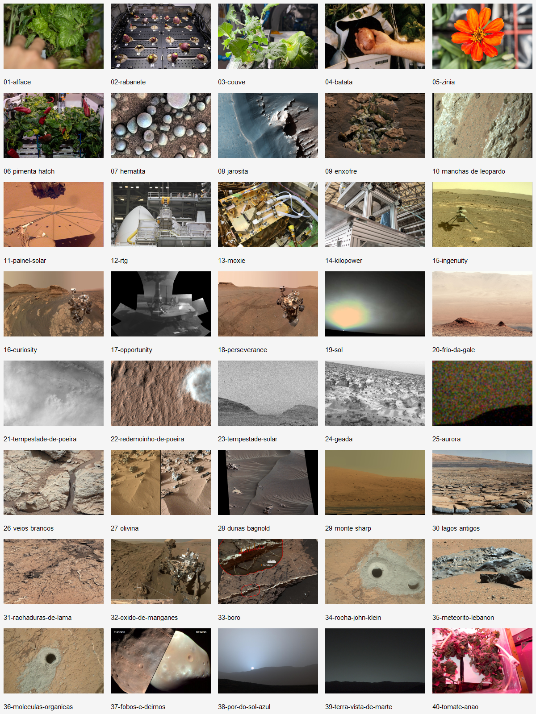

# Conferencia das fotos das cartas

Estado atual apos o pull 39b3597. Este relatorio substitui as anotacoes preliminares anteriores.

- 40 de 40 imagens de entrega presentes em fotos/, todas PNG validas.
- Todas as 40 imagens de entrega tem 944 x 614 pixels, a dimensao da janela documentada em design/05-telas/moldura-carta.md. Recortes preservam a proporcao e preenchem toda a janela, sem margens adicionadas. Fontes menores foram ampliadas por interpolacao convencional para atender ao pedido do time, sem sintese de detalhes.
- Nenhum conteudo visual foi gerado por IA. Fontes e fatos continuam no cartas.csv; atribuicoes no creditos.csv; downloads, dimensoes e hashes no fotos.csv.
- As cartas continuam pendentes da revisao visual do time. Credito completo das fotos 01 e 02 ainda precisa de confirmacao antes de uso no jogo.
- A tarefa nao foi marcada como concluida e nao houve commit nem push.

## Previa

## Pontos para revisar

| Carta | Observacao |
|---|---|
| 01 | Credito completo a confirmar; foto de outro cultivo. |
| 02 | Credito completo a confirmar. |
| 03 | Cultivo diferente do fato de 2018; datas divergentes nos metadados da foto. |
| 04 | Recorte aprovado para revisao; manter a verificacao do novo fato sobre produtividade. |
| 06 | Foto substituida por pimentas vermelhas nas plantas do experimento PH-04. Credito NASA. |
| 08 | Imagem orbital de Noctis Labyrinthus; a carta cita Opportunity/Meridiani. |
| 17 | Selfie parcial em preto e branco. |
| 19 | Imagem historica com resolucao limitada. |
| 20 | Detalhe enquadrado de panorama em resolucao maior; imagem de contexto, nao mede o frio. |
| 21 | Foto orbital da tempestade em Melas Chasma (2003). Ilustra o evento; nao e a mesma observacao de energia do InSight citada no fato. |
| 22 | Redemoinho orbital; o fato atualizado cita limpeza dos paineis do Spirit. |
| 25 | Recorte da observacao de aurora a esquerda na fonte, sem o painel comparativo nem a legenda. Foto cientifica de baixa luminosidade e ruido visivel. |
| 26 | Fotografia anotada do afloramento. |
| 27 | Par de fotografias do deposito Rocknest; nao mostra olivina isolada. |
| 28 | Detalhe da duna recortado da fonte em resolucao maior. |
| 29 | Detalhe do panorama; legenda da fonte informa extrapolacao de partes do ceu. |
| 30 | Depositos sedimentares atuais, nao um lago com agua hoje. |
| 31 | Detalhe fotografico Figure A de Pontours; substitui a vista ampla com lacunas pretas. |
| 32 | Mosaico do rover no local da descoberta, nao mineral isolado. |
| 33 | Montagem cientifica anotada; representa o veio que contem boro. |
| 36 | Foto estatica do furo Cumberland; nao mostra moleculas diretamente. |
| 37 | Montagem diagonal de fotos HiRISE de Phobos e Deimos. Recortes em escalas independentes; nao representa tamanho relativo nem alinhamento real das luas. |
| 39 | Terra e Lua sao pontos pequenos; conferir legibilidade. |

## Originais de couve e batata

Originais convertidos em PNG e metadados oficiais preservados em [originais/](originais/). Para a couve, AVAIL:DateCreated indica 26/10/2026 e a descricao indica 30/10/2026. Para a batata, a descricao cita legenda original de 14/08/1995 e DateCreated indica 02/05/2000. Nao usar datas de cadastro como datas da fotografia.

## Preparacao para as cartas

- Janela do Design: 944 x 614 na moldura de 1066 x 1280. O hud.gd atual usa KEEP_ASPECT_CENTERED e altura minima de 300; os arquivos padronizados preservam proporcao nesse modo.
- Recortes e margens registrados em enquadramento.csv. Copias anteriores preservadas em originais/antes-do-enquadramento/; fontes maiores para as cartas 20, 28, 29 e 31 preservadas em originais/.
- PNG 8 bits por canal, RGBA. Arquivos conferidos quanto a assinatura, dimensoes e bordas opacas; hashes atualizados em fotos.csv.
- Previa nas molduras em previa-nas-molduras.png: simulacao estatica apenas de foto e titulo. A descricao foi deixada vazia; nao e captura do jogo.
- As fotos 19 e 25 tem resolucao limitada; o preenchimento usa interpolacao convencional, preservando a limitacao da fonte. A carta 37 agora usa fontes mais detalhadas.
- A integracao no jogo cabe a Dev: executar node ferramentas/sincronizar.mjs e conferir as cartas no Godot e no celular. Nenhum arquivo de jogo/ foi editado nesta preparacao.

## Revisao solicitada pelo time

Todas as 40 fotos usam preenchimento integral (cover), sem faixas brancas nem transparentes adicionadas. A carta 21 usa foto real do evento e a 25 apenas uma vista da aurora. A carta 37 usa montagem diagonal identificada, com dois registros de credito. Originais mantidos para rastreabilidade. Esta revisao nao altera fatos ou traducoes. Push continua pausado.
