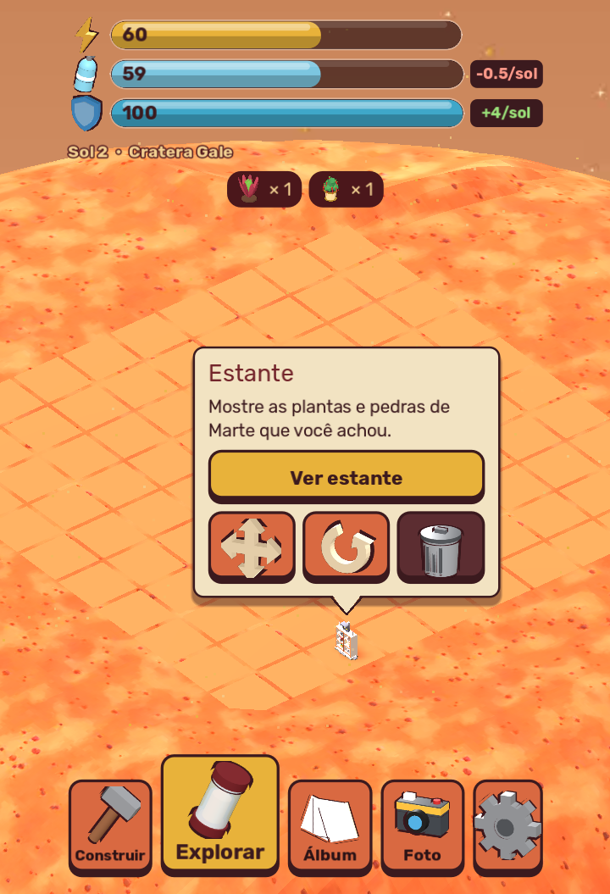
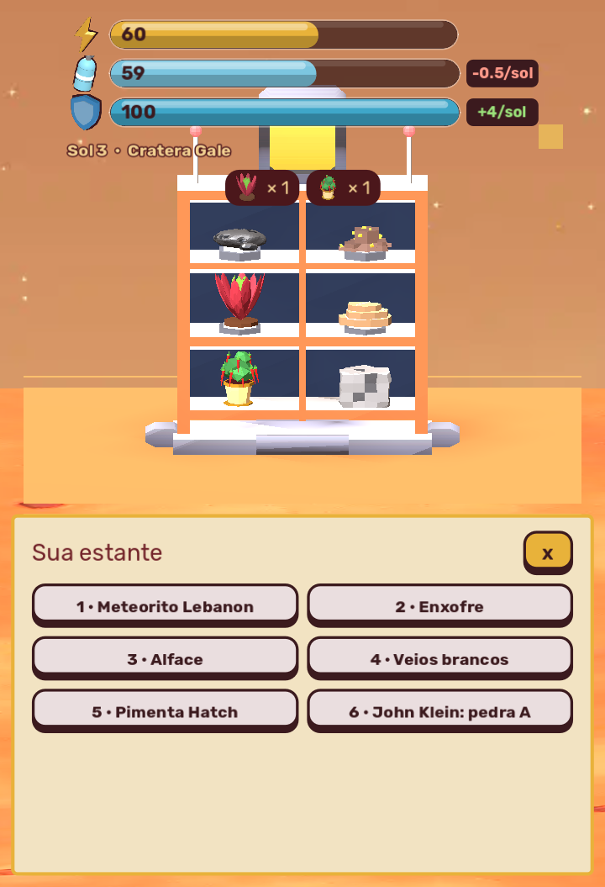
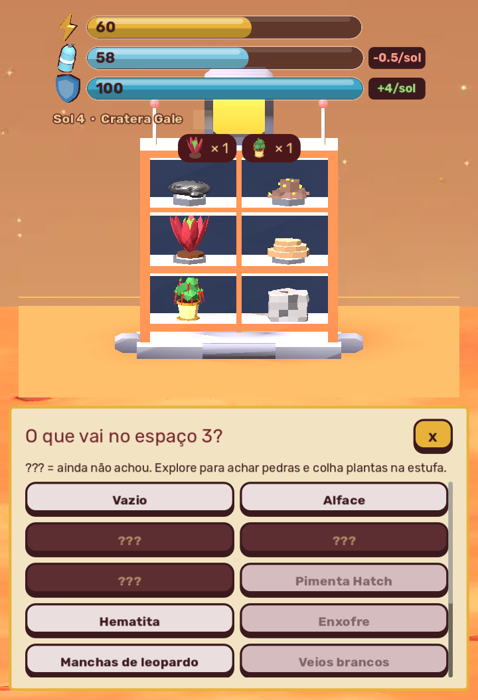

# Estante de exposição

Uma construção nova: uma estante espacial onde a criança expõe as plantas que colheu e as pedras que achou explorando.

| 1. Painel normal do item | 2. "Ver estante": zoom de frente, com o céu do jogo | 3. Escolher o que expor |
|---|---|---|
|  |  |  |

*Imagens tiradas do jogo de verdade, numa cópia com os passos abaixo já aplicados.*

## Como funciona

- **Construir:** igual a qualquer item (como o painel solar), pelo menu Construir. Custa 0 de energia e dá para ter só 1.
- **Tocar na estante:** abre o **painel normal do item**, com mover, girar e remover, e um botão dourado a mais: **"Ver estante"**.
- **"Ver estante":** a câmera vai para a frente da estante, de pertinho, com o **céu do jogo** atrás (o mesmo material do céu do `base.gd`). Embaixo abre o painel com as vagas.
- **Tocar numa vaga:** abre a lista de **tudo o que tem modelo 3D**: as 5 plantas e as 10 pedras. A criança só pode escolher o que já conquistou. O resto aparece como "???", como num álbum. Cada coisa entra numa vaga só, e "Vazio" esvazia a vaga.
- **X:** da lista volta para as vagas. Das vagas, fecha a estante e a câmera volta para onde estava.
- O que fica exposto é salvo com a base, em `State.items[chave].expo` (6 textos: `"plant:lettuce"`, `"rock:enxofre"` ou `""`).

## ⚠️ Regra do nível da Casa do Mike (importante)

| Casa do Mike | Estante |
|---|---|
| Nível 1 | **Não dá para construir.** O menu mostra "Melhore a Casa do Mike para o nível 2." (`NEED_HOUSE_2`) |
| Nível 2 | Dá para construir, com **3 vagas** (1, 2 e 3). As vagas 4, 5 e 6 aparecem trancadas com "Casa nível 3", e o painel avisa que o último nível libera mais 3. |
| Nível 3 (último, `State.MAX_LEVEL`) | **As 6 vagas.** |

- Quem decide isso é a função `vagas_liberadas()` no `estante.gd`, que lê o `State.house_level()`.
- Se a casa voltar a ter menos vagas, as coisas das vagas trancadas continuam salvas, mas não aparecem.
- A estante **não tem níveis próprios**. Quem libera as vagas é a casa, por isso o botão Melhorar não aparece nela (passo 3).

## O que pode ser exposto

| Coisa | Como a criança conquista | Modelo (`data/itens.json`) |
|---|---|---|
| Alface, rabanete, couve, zínia, pimenta | colhendo pelo menos 1 na estufa | o mesmo da estufa (`State.PLANTS[...].model`) |
| Enxofre | carta 9 (explorando) | `enxofre` |
| Veios brancos | carta 26 (explorando) | `veios-brancos` |
| Óxido de manganês | carta 32 (explorando) | `oxido-de-manganes` |
| John Klein: pedras A, B e C | carta 34 (explorando) | `john-klein-a`, `-b`, `-c` |
| Meteorito Lebanon | carta 35 (explorando) | `meteorito-lebanon` |
| Rocknest 3 | carta 41, quando o Conteúdo criar. Até lá, já começa liberada | `rocknest-3` |
| Hematita, Manchas de leopardo | as cartas 7 e 10 saíram do jogo, então começam liberadas | `hematita`, `leopardo` |

Para mudar o que libera cada pedra, mexa no `PEDRAS`, no começo do `estante.gd`.

## Para a Dev: como implementar (cerca de 20 min)

Tudo abaixo foi aplicado e testado numa **cópia** do jogo. A pasta `jogo/` não foi mexida.

1. **Modelos:** copie para `jogo/models/items/`:
   - o [estante.glb](../../03-itens-do-jogo/estante/estante.glb);
   - das [descobertas](../../03-itens-do-jogo/descobertas/descobertas.md): `veios-brancos.glb`, `rocknest-3.glb`, `oxido-de-manganes.glb`, `john-klein-a.glb`, `john-klein-b.glb`, `john-klein-c.glb` e `meteorito-lebanon.glb`.
2. **`jogo/data/itens.json`:**
   - em `files`, uma linha para cada modelo acima, com nome igual ao arquivo: `"estante": "estante.glb"`, `"veios-brancos": "veios-brancos.glb"` e assim por diante;
   - em `heights`, acrescente `"shelf": 1.8`.
3. **`jogo/autoload/state.gd`:**
   - no `ITEMS`: `"shelf": {"name": "D_SHELF", "cost": 0, "height": 1.8, "model": "estante", "max": 1, "house": 2},`
   - no `BUILDABLE`, acrescente `"shelf"` no fim;
   - em `build_block_reason()`, logo depois do `return "LOCKED_DECOR"`:
     ```gdscript
     if house_level() < int(def.get("house", 1)):
         return "NEED_HOUSE_%d" % int(def.house)
     ```
   - em `upgrade_cost()`, troque `if it.is_empty():` por `if it.is_empty() or it.type == "shelf":`. A estante não tem nível, quem libera as vagas é a casa.
4. **Script:** copie o [estante.gd](estante.gd) para `jogo/scenes/`.
5. **Textos:** acrescente as linhas do [textos.csv](textos.csv) ao `jogo/data/textos.csv`. São 20 chaves, já em pt_BR, en, es e fr, e a dupla de Conteúdo pode revisar.
6. **`jogo/scenes/base.gd`, em `_sync_items()`:** logo depois de `add_child(n)`, acrescente:
   ```gdscript
   if it.type == "shelf":
       preload("res://scenes/estante.gd").vestir(self, n, it)
   ```
7. **`jogo/scenes/hud.gd`:**
   - junto das outras variáveis: `var _estante: Control`
   - em `_ready()`, depois de `_root.add_child(_info_construcao)`:
     ```gdscript
     _estante = preload("res://scenes/estante.gd").new()
     _root.add_child(_estante)
     ```
   - em `_refresh_panel()`, logo **antes** de `if State.base_locked_reason() != "":`:
     ```gdscript
     if it.type == "shelf":
         var chave := State.key(selected)
         var ver := _add_panel_button(tr("BTN_SHELF"), func() -> void:
             _close_panel()
             _estante.abrir(chave), true)
         ver.set_meta("base_color", Palette.GOLD)
         _style_key(ver, true)
     ```
8. **Testar:**
   - Com a casa no nível 1, a estante aparece trancada no menu.
   - Com a casa no nível 2: construa a estante, toque nela e depois em "Ver estante". A câmera vai para a frente dela, com o céu atrás, e mostra 3 vagas livres e 3 trancadas.
   - Colha uma alface e coloque-a na vaga 1: ela aparece no pedestal.
   - Com a casa no nível 3, as 6 vagas ficam livres.

## Ajustes finos (constantes no começo do `estante.gd`)

| Constante | Hoje | O que muda |
|---|---|---|
| `ALTURA_NA_TELA` | 0,42 | quanto da tela a estante ocupa no zoom |
| `CENTRO_NA_TELA` | 0,30 | a altura dela na tela (0 = topo), acima do painel |
| `INCLINACAO` | −12° | o ângulo da câmera no zoom. O jogo usa −35,264° |
| `FUNDO_ATRAS` | 1,2 m | a que distância atrás da estante fica o céu |
| `TAM_VAGA` | 0,17 | o tamanho de cada coisa exposta |

## O modelo

| Parte | De onde vem |
|---|---|
| A estante | `bookcaseClosedWide` da [Furniture Kit](https://kenney.nl/assets/furniture-kit), repintada |
| A base e a telinha no topo | `structure-panel` e `display-wall` do [Space Station Kit](https://kenney.nl/assets/space-station-kit) |
| Divisória, 6 pedestais, luzes ciano e antenas | feitos pelo time: [estante.py](../../03-itens-do-jogo/estante/estante.py) |

O `estante.glb` tem 6 nós vazios, `vaga-1` a `vaga-6`, um em cada pedestal. É neles que o `vestir()` coloca os modelos. Medidas: [vagas.csv](../../03-itens-do-jogo/estante/vagas.csv).
